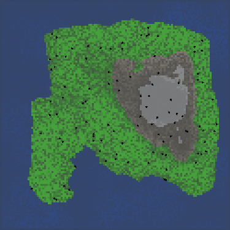
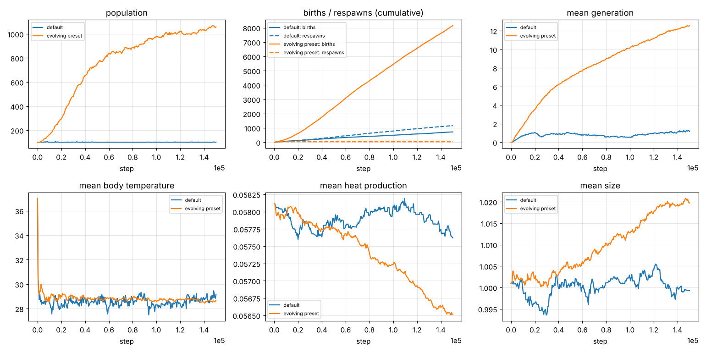

# World-Simulation

An artificial-life simulation on a Perlin-noise island. Organisms have to:
- find food
- keep their body temperature between freezing and overheating
- avoid or attack each other
- reproduce

Every organism has its own neural-network brain. Offspring inherit the brain and the body (size, colour, heat production, heat loss) with mutations, so behaviour and bodies evolve.



*Seed 2 with the `configs/evolving.ini` preset, 12 000 steps. Brightness is food; dots are organisms with a heading tick.*

## Build and run

You need a C++17 compiler. [SFML](https://www.sfml-dev.org/) 2.5+ or 3 is needed for the viewer only. [doctest](https://github.com/doctest/doctest) is needed for the tests.

```bash
sudo apt install libsfml-dev doctest-dev     # Debian / Ubuntu
make            # ./wsim (viewer + headless)
make headless   # ./wsim-headless, no SFML needed
make test

./wsim                                        # viewer, Constants.ini, random seed
./wsim --config configs/evolving.ini --seed 2
./wsim --no-window --steps 150000 --seed 2 --csv stats.csv --every 500
./wsim --no-window --steps 12000 --dump-dir frames --dump-every 100 --scale 3
python tools/render_gif.py frames --out world.gif
python tools/plot_stats.py "default=stats.csv" --out evolution.png
```

CMake works too:

```bash
cmake -S . -B build && cmake --build build && ctest --test-dir build
```

**Viewer controls:**
- **space**: pause
- **↑ / ↓**: steps per frame (×1 … ×1024)
- **1 / 2 / 3**: terrain / food / temperature overlay
- **left click**: inspect an organism (its body, outputs, and every neuron's activation)
- **N**: new world
- **Esc**: quit

All parameters are in `Constants.ini`. These optional keys are also read:
- `Island_mode`
- `Min_land_fraction`
- `Spawn_on_land`
- `Age_per_step`
- `Min_random_weight`, `Max_random_weight`
- `Mutation_chance`, `Mutation_perturbation`
- `Sigmoid_stretch_x`, `Sigmoid_stretch_y`

## The model

Per step, every organism senses, thinks, moves, exchanges heat, pays its energy upkeep, eats, maybe attacks, ages and maybe breeds. Afterwards the world updates. Neighbour perception uses the positions at the start of the step.

**World.** Height comes from 7-octave Perlin noise, and in island mode a radial falloff $1 - e^{m (\Delta x^6 + \Delta y^6)}$ is subtracted. Water, grass, stone and snow are height bands, set as fractions of the noise maximum. Land temperature:
- peaks at `Opt_temperature` at a middle height
- falls linearly towards `Low_temperature` at the top
- gets noise added

Water sits at `Temperature_of_water` ± 1.5. Every step, each tile's temperature relaxes back towards its natural value at rate 0.001. Food on inner tiles regrows as $f \leftarrow \min\big(f_{\max},\, f + U(0,1)\,(f_{\max}-f)\,g\big)$.

**Brain.** A fully connected network with layers of size
- inputs: $3R^2 + 7N + 7$
- $(L-2)$ hidden layers of half that size
- 5 outputs

Each layer has its own weights and biases. The activation is $Y\,(\sigma(-X s) - \tfrac12)$, so outputs lie in $(-\tfrac Y2, \tfrac Y2)$. The weights never change during an organism's life. Its children get a copy where each weight, with probability $p$, is perturbed by ±15 %, and with probability $p$ is replaced by a new random value.

**Inputs, all in the organism's own frame (forward / left):**
- *View grid:* an $R\times R$ grid of tiles in front of it, giving temperature/$T_\text{opt}$, food/$f_{\max}$, and the number of other organisms on each tile.
- *Neighbours:* the $N$ nearest organisms, giving relative position/radius, size, alpha, blue, green and red.
- *Own body:* temperature, energy/max energy, size, and colour.

**Outputs:**
- forward speed
- turning
- breed if $> 0$
- (unused)
- attack if $> 0$

**Body.** Efficiency is $\eta = \operatorname{clip}(1 - |T - T_\text{opt}|/T_\text{opt}, 0, 1)$, and speed and turning are scaled by $\eta/\text{size}$. Movement is slowed in water. The other body equations:

$$T \leftarrow T + h\,P - h\,k\,(T - T_\text{tile}), \qquad
E \leftarrow E - (\text{size}^2 c_s + P + c_m w\, v^2), \qquad
\text{food} = \eta\, c_f\,(1 - |o_0|).$$

- *Heat:* body heat production $P$ and heat loss $k$ evolve. Part of the lost heat warms the tile.
- *Energy:* $w$ is the extra movement cost in water. Death comes at $T \le 20$, $T \ge 42$ or $E \le 0$, and becomes increasingly likely past `Avg_age_death`.
- *Attack:* steals $\text{size}\cdot$`Attack_damage` energy from the nearest organism within size/2.
- *Breeding:* costs `Newlife_energy_constant`. The child starts with `Starting_energy`, inherits brain and body with mutations, and is placed at the parent's position.

**Population floor.** Random organisms are added, on land, when the population falls below `Min_number_organisms`.

## Results

Two 150 000-step runs on seed 2 (`results/*.csv`). The default `Constants.ini` is compared with `configs/evolving.ini`, which differs only in a 10× faster food regrowth (`Food_growth_factor` 0.0009):



| after 150 000 steps | default | evolving preset |
|---|---|---|
| population | 101 (at the floor) | 1059 |
| births / respawns | 721 / 1159 | 8144 / 33 |
| mean (max) generation | 1.2 (6) | 12.5 (27) |

**Default parameters.** The population sits at the floor of 100 and is kept alive by respawns: there are more respawns than births. This matches the 2018 note "organisms still don't have a real evolution". Food regrows at about $10^{-4}$ per tile per step. That is too slow to feed a population that reproduces by itself.

**Evolving preset.** Births take over after a few thousand steps. The population grows to about 1000, and lineages reach generation 27 in 150 000 steps. Mean heat production drifts down about 3 % (less energy burnt) and mean size up about 2 %. Those are small trends from a single run, not yet evidence of adaptation; several seeds would be needed to tell selection from drift.

## Changes from the 2018 version

The model and parameters are the same. These bugs are fixed:

- **Nearest neighbours:**
  - The search used `find(...) != end()`, so it only accepted organisms already chosen and the 28 neighbour inputs were always 0.
  - Each organism also counted itself on its own tile.
- **Brain:** all layers read their weights from offset 0, so they shared weights. Each layer now has its own weights and biases.
- **Breeding:**
  - It wrote the child's mutated heat production back into the parent.
  - The heat-loss clamp assigned to the wrong variable.
  - Colour mutation drifted upwards (`randomInt(-4, 5)`).
- **Config loading:**
  - `Heat_time_factor` was read from `Energy_heat_production`.
  - `Temperature_fluctuation_factor` overwrote the air-flux factor.
  - `Frequency` was parsed as an integer.
- **Movement and eating:**
  - Turning was always slowed by the water factor.
  - A negative efficiency made cold organisms move backwards and eat negative food.
  - The eating formula divided by zero at zero efficiency.
- **Update loop:**
  - Children were inserted while iterating over the vector.
  - A dead organism was replaced by the last one, which then skipped its update.
  - The breeding check scanned every organism for each organism.
- **World generation:**
  - The island height range tracked the falloff twice.
  - The colour inputs had red twice and no green.
  - Some seeds produced a world without land; those are regenerated.
- **Speed:** all neighbour queries were $O(N^2)$. A spatial hash grid now handles them; 1000 organisms run at about 250 steps/s on one core.
- **Reproducibility:** four unseeded RNGs are replaced by one seeded generator, so a seed reproduces the whole run. The Perlin permutation no longer depends on the standard library.
- **Platform and tests:**
  - It was Windows-only and committed SFML DLLs; it now builds with SFML 2 and 3 on any platform, and headless without SFML.
  - There were no tests or CI; now there are both.

Also new:
- **Heading-relative sensing**, as planned in the 8.12.2018 note in [`docs/log.md`](docs/log.md).
- **New organisms spawn on land** (`Spawn_on_land`). Previously about half spawned in the sea and froze.

The tests (doctest, run under ASan and UBSan in CI) cover:
- config parsing
- the brain's forward pass, computed by hand
- nearest neighbours against brute force
- heading-relative inputs
- landscape properties
- seed determinism
- invariants over a long run with heavy breeding: bounds, energy ≤ max, trait limits, bodies never change during life, and population bookkeeping

## Layout

```
include/wsim/   params.hpp (Constants.ini), brain.hpp, world.hpp (landscape, organisms, simulation), render.hpp
src/main.cpp    headless runner and SFML viewer
tests/          doctest suite
configs/        evolving.ini preset
tools/          render_gif.py, plot_stats.py
third_party/    PerlinNoise.hpp (siv::PerlinNoise, MIT, Ryo Suzuki)
```
